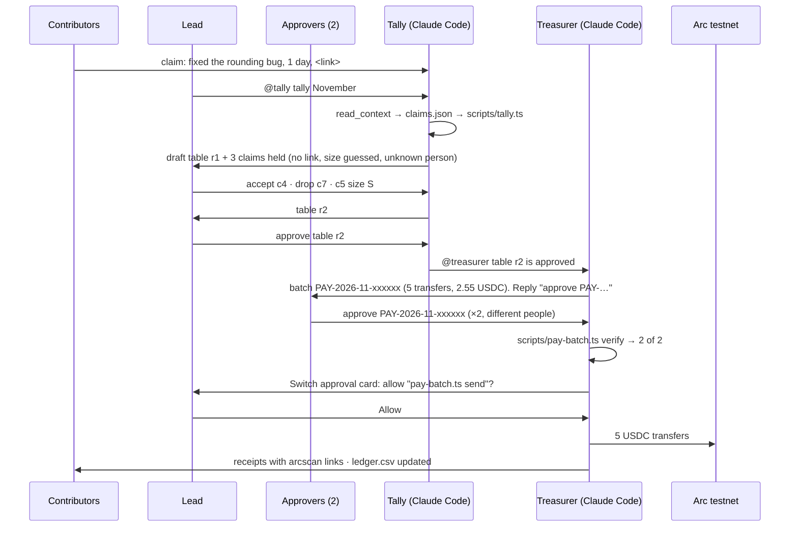

# Payday Room

**A Switch room where AI agents do the tedious part of paying contributors, and people keep the decisions.** Contributors post what they did. **Tally**, a Claude Code agent, applies the written payout rules and drafts the month's table. A human lead approves it. **Treasurer**, a second Claude Code agent, turns it into a batch of USDC transfers on Arc testnet. It sends only after **two different people** approve that exact batch in the chat, and then posts every receipt.

Built for **Flip the Switch** (WeMakeDevs × Switch), Track 1: Best Business Workflow.

> Demo video: _link added on submission_ · Testnet only: no real money moves.

## Why

I've waited three months to be paid by a crypto project, then had to chase it. At another, payouts lagged because nobody wanted to tally the month's work. The tally is a grind people avoid. The sign-off can't be automated away, because it's someone's money.

So the room splits the job. Agents do the reading, the arithmetic and the transfers. People do the judging and the approving, in the same chat where the work was claimed, with the whole trail kept.

## One payday, step by step



1. **Contributors post claims** in the Payday Room in plain words, with a link: `claim: wrote the setup guide, half a day <link>`. A lead can post for someone with `for @ada: …`.
2. **The lead asks Tally to tally the month.** Tally reads the room through Switch, writes `payday/<month>/claims.json`, and runs `scripts/tally.ts`, which applies [`PAYOUT_RULES.md`](PAYOUT_RULES.md): points per task and size, a 3 USDC pool, a 10% reserve, a 35% cap and rounding down. Tally posts the table and **holds** anything unclear: no evidence, a guessed size, a duplicate link, someone not in [`team.yaml`](team.yaml).
3. **The lead fixes or approves it in the thread** (`accept c4`, `drop c7`, `c5 size S`, `approve table r2`). Only the lead named in `team.yaml` can do this; the script checks.
4. **Treasurer plans one batch** with `scripts/pay-batch.ts plan`. The batch id is a hash of who gets what, so `approve PAY-2026-11-3f9a1c` can only ever approve that exact list.
5. **Two different approvers reply** `@treasurer approve PAY-…`. Treasurer copies their messages from the room into `approvals.json`, and `pay-batch.ts verify` counts them: they must be in `team.yaml`, quote the id, come after the batch was posted, and not be paid in it.
6. **Switch asks a person to allow the send.** `pay-batch.ts send` is an "ask" command in the agents' permissions, so Switch posts an approval card in the room and the command waits for a human to press Allow.
7. **Treasurer sends and reports.** One USDC transfer per person on Arc testnet, each receipt checked, links posted in the room, and every transfer appended to [`ledger.csv`](ledger.csv). A month that's in the ledger can't be paid again.

## How Switch is used (and why it doesn't work without it)

| What the workflow needs | What Switch provides |
|---|---|
| Two agents and several people in one conversation | A **Switch room** bridged to Telegram (or Slack, Discord, Mattermost). Tally and Treasurer are **Claude Code agents run by Switch Console** on this Mac and joined to the room. |
| Agents that can read what people claimed and approved | The agents' **Switch tools**: `read_context` to read the room's history with who said what, `post_message` to answer in the thread. Claims and approvals never leave the chat. |
| Agents that answer the right people | **Addressing**: anyone in the room can talk to them, nobody outside it can. |
| A human stop before money moves | **Switch approval cards.** The send command needs permission, so Switch puts an Allow/Deny card in the room and the agent waits. |
| A record of who decided what | The **room itself**: every claim, edit, approval and receipt is in one thread, next to `ledger.csv`. |
| A setup another team can copy | A **Switch template** ([`switch/payday-room.template.yaml`](switch/payday-room.template.yaml)) that creates both agents and the room in one go. |

Without Switch there is no room for the agents to read claims from, nobody to post the table to, no way for two approvers to answer the agent, and no approval card in front of the send. You'd be back to a spreadsheet and a lead with a private key.

## Set it up in 10 minutes

You need macOS, Node 23.6 or newer, a Telegram account, and Claude Code signed in (`claude auth login`).

1. **Install Switch Console** from [Switch's releases](https://github.com/sandbox-quantum/switch/releases) and open it. Its local server runs natively; no Docker needed.
2. **Clone this repo** where both agents will work:
   ```bash
   git clone https://github.com/0xkenichi/payday-room ~/payday-room && cd ~/payday-room && npm install
   ```
3. **Make a testnet treasury.** Copy `.env.example` to `.env` and put a fresh testnet-only key in it. Fund it with testnet USDC at [faucet.circle.com](https://faucet.circle.com) (Arc testnet, 20 USDC every 2 hours). Check it: `npm run balance`.
4. **Edit `team.yaml`:** your lead, your two approvers (chat usernames), and your contributors' testnet wallets.
5. **Connect Telegram to Switch:** in @BotFather, `/newbot`. In Switch Console: Home → Messaging apps → Connect → Telegram, with the bot's token and username. Make a Telegram group, add the bot, and **make the bot an admin** so Switch sees every message, not only mentions (or turn Group Privacy off in BotFather first). Post once, then link your Telegram account in Console (Home → Link account).
6. **Let this Mac run agents:** in Console, open Your Agents → Add agent once. That enrolls this computer as an agents controller; you can cancel the dialog.
7. **Create the agents from the template:** Templates → Import template → choose `switch/payday-room.template.yaml` → Use. Switch the room to your Telegram group's room, set the folder to your clone (an absolute path), then Create agents.
8. **Run a payday:** post claims in the group (`for @ada: … <link>`), then `@tally please tally 2026-11`. Approvers answer Treasurer with `@treasurer approve PAY-…`: Switch only wakes an agent when it's mentioned.

`npm test` runs the rule and approval checks offline.

## Safety

- **Testnet only.** `pay-batch.ts` refuses any chain but Arc testnet (5042002), whatever the RPC says.
- **No key in any prompt.** The treasury key lives in `.env`, which the script reads when it sends. The agents' permissions (`.claude/settings.json`) deny reading `.env`, `cat`, `env` and `printenv`, and deny editing the scripts, the rules, the team file and the ledger.
- **The agent can't skip the humans.** The approval check is in the script, not in the prompt: two different approvers from `team.yaml`, quoting the batch id, after the batch was posted, and not paid in it. Then Switch's approval card gates the send command itself.
- **Approvals can't be reused.** The batch id is a hash of the month, the approved table, the chain, the token, the sender and every transfer. Change one cent and it's a different batch.
- **Paid once.** Each transfer's hash is saved before its receipt is awaited, so a crash can't double-pay, and a month already in the ledger is refused.
- **Agents don't judge.** Unclear claims are held for the lead. Unknown people and unknown tasks can't be accepted until a human edits `team.yaml` or the rules in a pull request.

**Known limit:** Treasurer copies the approvals out of the room into `approvals.json`. The script checks everything about them, but it trusts that copy. The next step is for `pay-batch.ts` to fetch the approvals from Switch itself, so even a misbehaving agent couldn't invent one.

## Files

| Path | What it is |
|---|---|
| [`PAYOUT_RULES.md`](PAYOUT_RULES.md) | The rules, in prose and in the YAML block the scripts read |
| [`team.yaml`](team.yaml) | Lead, approvers, contributors and their testnet wallets |
| [`scripts/tally.ts`](scripts/tally.ts) | Claims → draft table, flags, lead approval |
| [`scripts/pay-batch.ts`](scripts/pay-batch.ts) | Approved table → batch → approval check → USDC transfers → ledger |
| [`switch/`](switch) | The Switch template and the two agents' instructions |
| [`.claude/settings.json`](.claude/settings.json) | What the agents may run, must ask for, and may never touch |
| [`payday/`](payday) | Each month's claims, tables, batch, approvals and receipts |
| [`ledger.csv`](ledger.csv) | Every transfer ever sent, with its explorer link |
| [`docs/rehearsal/`](docs/rehearsal) | A script-only dry run on testnet before Switch was wired in |

## Credits

Built by [@0xkenichi](https://github.com/0xkenichi) during Flip the Switch, 4–7 November 2026, with [Switch](https://github.com/sandbox-quantum/switch) by SandboxAQ, Claude Code, [viem](https://viem.sh) and Circle's [Arc](https://arc.network) testnet. MIT licensed.
